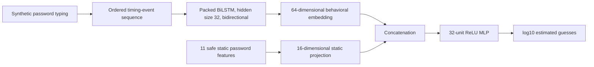

# BiLSTM fusion experiment

> **Synthetic-data disclaimer:** These experiments use generated sessions. They do not represent real users and must not be interpreted as real-world validation.

## Purpose

This experiment restores the sequence-modeling component proposed in Review 0 while preserving the existing leakage-aware Random Forest baseline. It evaluates three small CPU models against the unchanged 15,000-row synthetic aggregate dataset and a new, exactly aligned sequence artifact.

## Architecture



The behavioral-only model uses the same BiLSTM with a 32-unit regression head. The static-only model uses an `11 → 32 → 16 → 1` ReLU MLP.

## Sequence artifact and schema

`data/synthetic/behavepass_sequences.jsonl` contains 15,000 lines linked one-to-one to the existing CSV by `session_id`. The existing aggregate CSV was not changed.

Each JSON line contains:

```text
session_id
participant_code
source = synthetic_behavepass_sequence_v1
sequence_length
events[]
```

Each ordered event contains:

```text
sequence_index
normalized_position
press_time_ms
release_time_ms
dwell_time
flight_time
press_to_press_latency
release_to_press_latency
is_pause
is_backspace
```

The first flight/latency values are `null`. No plaintext password, key character, or raw key code is stored. Release-to-press latency is retained in the artifact for semantic clarity; because it is identical to the application's flight-time definition, it is not duplicated in the model tensor.

All 15,000 regenerated aggregate rows matched the unchanged CSV before JSONL was written. Sequence-derived mean/std dwell, mean/std flight, press latency, longest delay, pause count/duration, backspace count, keypress count, and total duration pass alignment validation.

Sequence lengths:

- Minimum: 6
- Mean: 13.0597
- Maximum: 27

## Inputs and leakage controls

The six model sequence channels are:

```text
dwell_time, flight_time, press_to_press_latency,
normalized_position, is_pause, is_backspace
```

The fusion/static models use the 11 safe static features defined by the baseline analysis. They exclude `zxcvbn_score`, the target, and target-derived values.

Never-model metadata includes `participant_code`, `typing_profile`, `source`, `session_id`, and `synthetic_seed`. Identifiers are used only for joining and grouped splitting.

Variable-length sequences use `pad_sequence`, explicit boolean masks, and `pack_padded_sequence`, so padded positions do not contribute to the BiLSTM state. Sequence and static means/standard deviations and target scaling are fitted only on training participants and saved in `ml/results/sequence_preprocessing.json`.

## Participant-grouped split

The original baseline's seed-42 test allocation is reused exactly. Its non-test participants are split again by participant for validation:

| Partition | Sessions | Synthetic participants |
|---|---:|---:|
| Train | 9,528 | 153 |
| Validation | 2,443 | 39 |
| Test | 3,029 | 48 |

There is zero participant overlap. Test data remains untouched during optimization and early stopping.

The historical Random Forest used all 11,971 non-test rows because it did not require neural early stopping. Its test set is identical, but its effective fitting set is larger than the neural training subset; this should be considered when comparing results.

## Hyperparameters

- PyTorch 2.14.0, CPU
- Fixed seed: 42
- BiLSTM layers: 1
- Hidden size: 32 per direction
- Behavioral embedding: 64
- Dropout: 0 (appropriate for one LSTM layer)
- Batch size: 128
- Maximum epochs: 18
- Loss: Huber, delta 1.0, on normalized target
- Optimizer: Adam
- Learning rate: 0.001
- Weight decay: `1e-5`
- Gradient-norm clipping: 5.0
- Early-stopping patience: 4 epochs
- Checkpoint criterion: minimum validation loss

## Held-out results

| Model | MAE | RMSE | R² | Epochs |
|---|---:|---:|---:|---:|
| Safe-static Random Forest | 0.3113 | 0.8106 | 0.9619 | — |
| Static-only MLP | 0.4647 | 0.8914 | 0.9539 | 18 |
| Behavioral-only BiLSTM | 0.8210 | 1.3223 | 0.8987 | 8 |
| BiLSTM + safe-static fusion | 0.5210 | 0.9343 | 0.9494 | 18 |

Compared with the static-only MLP, fusion:

- worsened RMSE by 0.0428 (4.81%)
- reduced R² by 0.0045
- worsened MAE by 0.0563

Compared with the safe-static Random Forest, fusion:

- worsened RMSE by 0.1237 (15.26%)
- reduced R² by 0.0125
- worsened MAE by 0.2097

## Interpretation

Sequence-level behavioral information did **not** improve prediction beyond safe static inputs in this experiment. The behavioral BiLSTM does learn the generator's correlations, reaching R² 0.8987, but fusion underperforms both the static MLP and the classical Random Forest.

This null result is scientifically acceptable. The target is generated entirely from password content, and synthetic timing correlations do not supply independent human behavior. Increasing neural complexity would risk fitting generator assumptions rather than answering the real BehavePass research question.

## Saved artifacts

Generated datasets and checkpoints remain local/ignored:

- `data/synthetic/behavepass_sequences.jsonl`
- `ml/checkpoints/behavior_bilstm.pt`
- `ml/checkpoints/static_mlp.pt`
- `ml/checkpoints/fusion_bilstm.pt`

Reviewable metadata/results:

- [`neural_experiment_results.csv`](../ml/results/neural_experiment_results.csv)
- [`neural_training_history.json`](../ml/results/neural_training_history.json)
- [`sequence_preprocessing.json`](../ml/results/sequence_preprocessing.json)

## Figures

- [Training and validation loss](../ml/results/figures/neural_training_loss.svg)
- [RMSE comparison](../ml/results/figures/neural_rmse_comparison.svg)
- [Fusion actual versus predicted](../ml/results/figures/fusion_actual_vs_predicted.svg)

## Remaining Review 0 discrepancy and next step

The architecture is now implemented end-to-end, but it is trained only on synthetic aggregate-aligned sequences rather than real creation-time sessions. Review 0 described a 128-dimensional embedding; this CPU proof of concept intentionally uses a smaller 64-dimensional embedding (32 units per direction), within the requested lightweight range. PassGAN remains unimplemented as required. The trained fusion checkpoint is now connected to FastAPI for the final proof-of-concept demonstration.

The next step is not a larger neural network. It is collection of sufficient consented, real password-creation sequences and a preregistered participant-grouped comparison of static-only versus fusion models. Only real held-out improvement would justify further sequence-model tuning.
