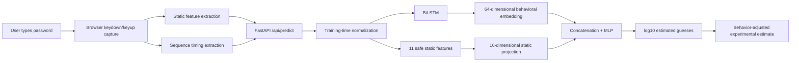

# Final system architecture

## Implemented flow

```text
User types a synthetic password
  -> browser keydown/keyup capture
  -> in-browser static feature extraction
  -> in-browser sequence timing extraction
  -> FastAPI POST /api/predict
  -> static assessment, timing summary, and experimental fusion estimate
```



## Behavioral path

Each completed keystroke contributes dwell time, flight time, press-to-press
latency, pause status, and backspace status. The backend derives normalized
sequence position and arranges the exact six training channels. Saved training
means and standard deviations normalize the sequence before a bidirectional
LSTM with 32 hidden units per direction produces a 64-dimensional behavioral
embedding.

## Static and fusion paths

The static path selects the exact 11 safe features recorded in the preprocessing
metadata. It excludes the zxcvbn score, prediction target, identifiers, and
synthetic metadata. Saved training statistics normalize these inputs before a
16-dimensional static projection. The behavioral embedding and static
representation are concatenated and passed through the trained MLP. The saved
target mean and standard deviation convert its output back to log10 estimated
guesses.

## Frontend output

The frontend keeps three concepts distinct:

- the conventional static zxcvbn assessment;
- a descriptive behavioral timing summary;
- the behavior-adjusted experimental fusion estimate.

It does not claim that behavioral input makes a password stronger.

## Privacy design

Plaintext exists transiently only in browser memory for static extraction. The
browser sends derived counts, entropy estimates, timing intervals, and boolean
pause/backspace flags. It does not send plaintext, raw key characters, key
codes, or typing-profile metadata. SQLite stores only those derived features.

## Artifacts and loading

The backend expects `ml/checkpoints/fusion_bilstm.pt` and its matching
`ml/results/sequence_preprocessing.json`. The checkpoint is mapped to CPU,
validated against the saved feature dimensions, placed in evaluation mode, and
loaded lazily once per backend process. Inference uses `torch.no_grad()` and the
cached instance is reused.

The required checkpoint SHA-256 is:

```text
e7df2f6d14c0b36ba764de1243c69cdd101418087945fd1103459d40184a34a5
```

The matching preprocessing metadata SHA-256 is:

```text
f6f034fe512838ed31c50f0957e5328584b7bca62bf7130bc9d2ae7df76cced2
```

## Experimental interpretation

The trained sequence data is synthetic. The safe-static Random Forest remains
the strongest leakage-safe baseline, and fusion did not outperform either that
baseline or the static-only MLP. The architecture demonstrates end-to-end
technical feasibility; it does not establish incremental behavioral value or
real-user validity.
